<h1 align="center">
  <br>
  <a href="/">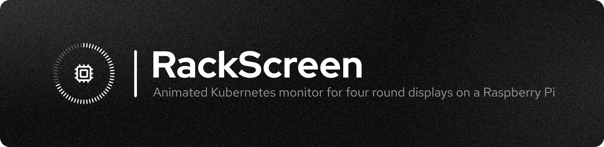</a>
  <br>
</h1>

<p align="center">
  <a href="https://github.com/silkepilon/RackScreen/releases/latest"></a>
  <a href="LICENSE"></a>
  <a href="https://github.com/silkepilon/RackScreen/actions/workflows/ci.yml"></a>
  
  
</p>

<p align="center">
  <a href="#install">Install</a> &nbsp;·&nbsp;
  <a href="#screens">Screens</a> &nbsp;·&nbsp;
  <a href="#setup-tui">Setup TUI</a> &nbsp;·&nbsp;
  <a href="#electricity-mode">Electricity mode</a> &nbsp;·&nbsp;
  <a href="#sky-roles">Sky roles</a> &nbsp;·&nbsp;
  <a href="#configuration">Configuration</a> &nbsp;·&nbsp;
  <a href="#development">Development</a>
</p>

---

RackScreen drives four GC9A01 240x240 round displays from a Raspberry Pi 3B+ and turns them into a live picture of your Kubernetes cluster and your grid. Each panel is one tile: a small icon in the gap of a round-capped ring, one big number, a status pill and a small card with the chart that suits the data (a sparkline, bars, a stacked bar, a compass). Values glide into place and only the digits that change roll; nothing wobbles while idle. A screen can cycle through several roles, crossfading via black in 0.4 s. Sixteen roles come from the cluster, four from [Electricity Maps](https://app.electricitymaps.com) and the day-ahead price feeds, seven from the sky over your house, two from GitHub and one from a Jellyfin server, so the same rack can show pods on one panel and today's electricity price on the next.

## Screens

Every GIF below is the real renderer fed by the simulator, one panel, 20 fps.

|  |  |
|:--:|:--:|
| 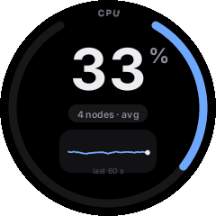 | 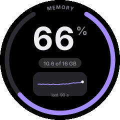 |
| **`cpu`** — cluster CPU load with the last minute as a sparkline; amber when the load is over the threshold | **`mem`** — cluster memory use, GB used of total, the last 90 s as a sparkline; amber when use is over the threshold |
| 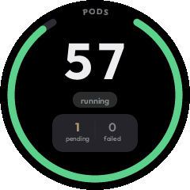 | 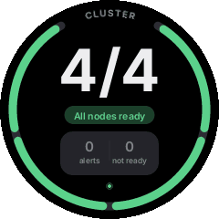 |
| **`pods`** — running pods; the ring split into running, pending and failed | **`health`** — one segment per node, alerts and not-ready counts; a live dot while the link is up |
| 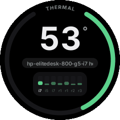 | 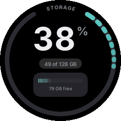 |
| **`thermal`** — the hottest node, amber and red near the threshold; a bar per node | **`storage`** — used capacity split per Longhorn volume; a degraded volume turns red |
| 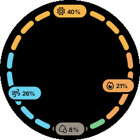 | 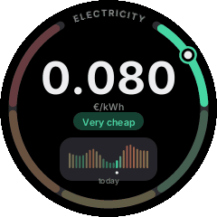 |
| **`power-mix`** — twenty 5 % segments by source, the leader first from the top right, a capsule with icon and share for every source worth two segments | **`price`** — today's price on its five bands, the marker where it sits between today's low and high, the hours as bars |
| 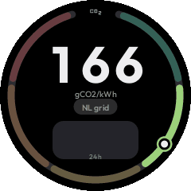 | 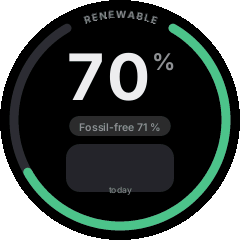 |
| **`carbon`** — grid carbon intensity on five bands, compared with the last 24 h | **`renewable`** — the renewable share, the fossil-free share in the pill, today as a sparkline |
| 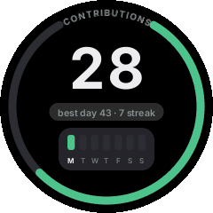 | 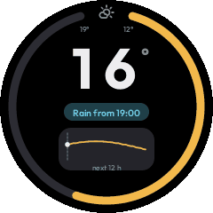 |
| **`gh-activity`** — today's contributions against your best day, this week as seven bars | **`weather`** — the temperature on the day's low to high, the condition and rain ahead in the pill, the next 12 h as a curve |
| 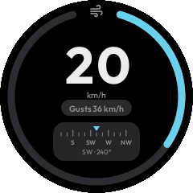 | 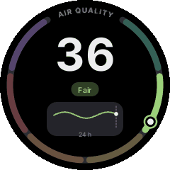 |
| **`wind`** — wind speed, gusts in the pill, a compass strip that slides to the direction | **`aqi`** — the European air quality index on its six bands, the last 24 h as a sparkline |
| 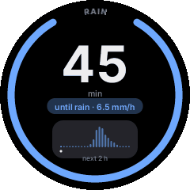 | 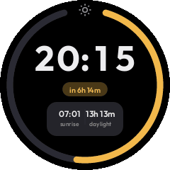 |
| **`rain`** — minutes until rain, the next two hours as five-minute bars | **`sun`** — the next event (Sunrise or Sunset) and its countdown in the pill, and how far the day or night has run |
| 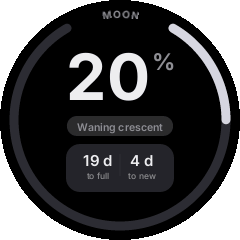 | 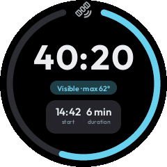 |
| **`moon`** — the illuminated fraction, the phase, days to full and new moon | **`iss`** — a countdown to the next ISS pass with its start, duration and height |
| 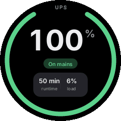 | 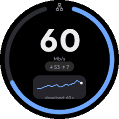 |
| **`ups`** — battery charge, on mains or on battery, runtime and load | **`net`** — total traffic, download and upload in the pill, download as a sparkline |
| 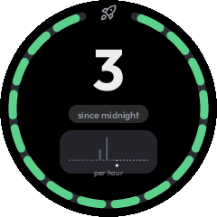 | 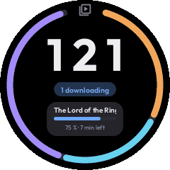 |
| **`deploys`** — Argo CD syncs today, one segment per application, syncs per hour | **`media`** — movies, series and artists on the ring; the active arr download in the card, or the last item added |
| 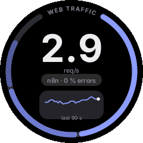 | 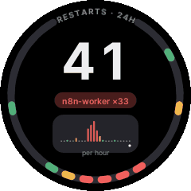 |
| **`traffic`** — Traefik requests per second, the three busiest services on the ring, the error share in the pill | **`restarts`** — container restarts in 24 h, one segment per hour coloured by count, the worst pod in the pill |
| 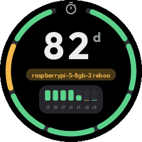 | 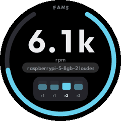 |
| **`uptime`** — the longest node uptime, a segment per node, amber for a reboot in the last day | **`fans`** — the loudest fan in rpm, a bar per node with a fan |
| 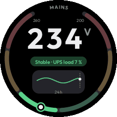 | 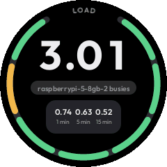 |
| **`mains`** — UPS input voltage on six bands over 200–260 V, the last 24 h as a sparkline | **`load`** — the highest 1-minute load, a segment per node by load per core, cluster means in the card |
| 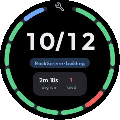 | 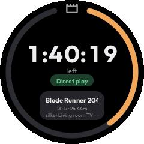 |
| **`ci`** — the last twelve GitHub Actions runs as segments, passes over total, the newest run in the pill | **`jellyfin`** — time left on what is playing, the ring is the position, direct play or transcoding, title and viewer in the card |

<p align="center">
  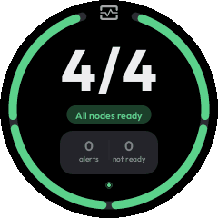
</p>
<p align="center">
  <b>HEALTH doubles as a download monitor.</b> When every node is ready, nothing is firing and qBittorrent is pulling, the health tile shows the most complete download instead: its progress on the ring, its name in the pill, speed and ETA in the card.
</p>

<p align="center">
  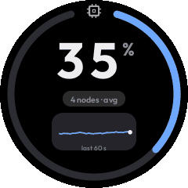
</p>
<p align="center">
  <b>One screen, every role.</b> A screen cycles through the roles you give it: the old role fades to black and the new one fades in, 0.4 s in all.
</p>

## Install

One line on the Pi, no clone:

    curl -fsSL https://github.com/silkepilon/RackScreen/releases/latest/download/install.sh | bash

It downloads the latest `aarch64` release and opens the setup menu. **Install** copies the binary to `/usr/local/bin`, writes `/etc/rackscreen/config.yaml`, installs the `rackscreen@<user>` service and offers to enable SPI in the boot files. The service runs `rackscreen run --config /etc/rackscreen/config.yaml`; later runs of the menu are just `rackscreen` (it asks for sudo).

> [!NOTE]
> Enabling SPI edits the boot files, so reboot the Pi afterwards before the panels light up.

To upgrade, re-run the one-liner, or use **Update** in the TUI, or `sudo rackscreen update`. It downloads the latest release, verifies its SHA-256, swaps `/usr/local/bin/rackscreen` and restarts the service; `rackscreen update --check` only reports (exit 0 up to date, 1 update available, 2 unknown). Your config is left alone either way.

Config is YAML at `/etc/rackscreen/config.yaml`, with the defaults in [`config.example.yaml`](config.example.yaml). The kubeconfig defaults to `~/k8s-monitor.yaml` of the service user. Upgrading from v0.1: `~/.config/rackscreen/config.toml` is no longer read, so re-enter your settings via **Configure**.

## Setup TUI

`rackscreen setup` (what the installer opens) is a ratatui shell: a sidebar on the left with the eight actions, a pane on the right, and a help row at the bottom. `↑↓` move the sidebar bar, `⏎` opens, `Esc` returns to Home (`←` does the same on screens that do not use it themselves; Configure and Calibrate do). Below 72 columns the sidebar folds away and Home shows the menu itself.

- **Home** — a live overview: service state and uptime, boot enablement, a dot per link (`k8s`, `prometheus`, `qbittorrent`, `argocd`, `weather`, `rain`, `github`, `electricity`, `prices`), what each screen cycles through (long lists end in `+N`), and the last three log lines.
- **Install** — set up service + config: binary, `/etc/rackscreen/config.yaml`, the `rackscreen@<user>` unit, optional SPI in the boot files.
- **Calibrate** — fix rotation / mirroring. The selected panel is drawn large in the terminal from the very frame the glass shows (half-block pixels in a true-colour terminal, assumed unless `TERM` is a plain `xterm`/`screen`/`linux`; set `RACKSCREEN_TRUECOLOR=0` or `1` to force it; otherwise a drawn circle), the other panels are a strip in the info column to the right. Press `r`/`R`/`f` until the arrow points up and the dot is top-right, `a` copies to all, `s` writes `rotate` and `hflip`.
- **Screens** — what each screen shows and how fast it cycles; see [Screens and roles](#screens-and-roles).
- **Configure** — every setting in seven groups (Cluster, Services, Energy, Sky, Media & Jellyfin, Display, Thresholds) listed in the sidebar: `Tab`/`←→` step through them, `1`–`7` jump straight to one, and `↑↓` flow from the last field of a group into the next; each module has an on/off badge and the focused field shows a one-line explanation. `s` saves everything and offers a restart; `Esc` with unsaved changes asks first.
- **Status** — the full service detail, links, boot files and the log tail; `l` for the log view, `r` to restart.
- **Run here** — run the daemon in the foreground with its logs, without touching the service.
- **Update** — download the latest release, verify its SHA-256, swap the binary and restart the service.
- **Uninstall** — remove the binary, config and service; the boot file lines stay.

## Screens and roles

Every screen shows one or more **roles** and cycles through them. Thirty roles exist:

| Role | Data source | Tile |
|---|---|---|
| `cpu` | Prometheus | ring the load, pill the node count or "High load", card the last minute |
| `mem` | Prometheus | ring memory use, pill GB used of total or "High memory", card the last 90 s |
| `pods` | Kubernetes API | ring running, pending and failed, card pending and failed counts |
| `health` | Kubernetes API + Prometheus | a segment per node, pill the first node not ready, card alerts and not-ready; the top download in download mode |
| `thermal` | Prometheus | ring the hottest node (amber from `hot node temp °C` − 5, red from + 5), card a bar per node |
| `storage` | Prometheus (Longhorn) | ring the used share per volume, pill used of total or the degraded volume, card a stacked bar and free space |
| `power-mix` | Electricity Maps | twenty 5 % segments by source, the leader first from the top right, a capsule per source worth two segments |
| `price` | Energy-Charts | five bands with a marker, pill the band, card today's hours as bars |
| `carbon` | Electricity Maps | five bands over 0 to 500 gCO2/kWh, pill against the last 24 h, card a 24 h sparkline |
| `renewable` | Electricity Maps | ring the renewable share, pill the fossil-free share, card today |
| `gh-activity` | GitHub | ring today against the month's best, pill best day and streak, card this week |
| `weather` | Open-Meteo | ring the day's low to high, pill the condition and the rain hint, card the next 12 h |
| `wind` | Open-Meteo | ring the speed, pill the gusts, card a compass strip |
| `aqi` | Open-Meteo | six bands with a marker, pill the level, card the last 24 h |
| `rain` | Buienradar | minutes to rain (or mm/h while raining), card the next two hours |
| `sun` | computed | the next sunset or sunrise, ring the day or night so far, pill the next event (Sunrise/Sunset) and the countdown |
| `moon` | computed | ring the illuminated fraction, pill the phase, card days to full and new |
| `iss` | Celestrak + SGP4 | a countdown to the next pass, pill visibility and height, card start and duration |
| `ups` | Prometheus (nut-exporter) | ring the charge, pill mains or battery, card runtime and load |
| `net` | Prometheus (node-exporter) | ring the total, pill down and up, card a download sparkline |
| `deploys` | Argo CD | syncs today, a segment per application, card syncs per hour |
| `media` | Prometheus (scraparr) + Radarr/Sonarr/Lidarr | ring movies, series and artists, pill the download count or the library size, card the active download or the last item added |
| `traffic` | Prometheus (Traefik) | req/s, ring the three busiest services, pill the busiest and the 5xx share, card the last 90 s |
| `restarts` | Prometheus (kube-state-metrics) | restarts in 24 h, a segment per hour (green 1, amber 2–5, red 6+), pill the worst pod, card restarts per hour |
| `uptime` | Prometheus (node-exporter) | longest uptime in days, a segment per node, pill the latest reboot, card days per node |
| `fans` | Prometheus (node-exporter hwmon) | loudest fan in rpm, ring over 8000, pill the node, card a bar per node |
| `mains` | Prometheus (nut-exporter) | input voltage on six bands, pill stable or low/high voltage with the UPS load, card the last 24 h |
| `load` | Prometheus (node-exporter) | highest 1-minute load, a segment per node by load per core, card the cluster means |
| `ci` | GitHub Actions | passes over the last twelve runs, a segment per run, pill the newest run, card average run time and failures |
| `jellyfin` | Jellyfin | time left, ring the position (amber movie, cyan episode, dim when paused), pill direct play / transcoding / paused, card title, episode or year and viewer |

**Screens** in the setup TUI edits them: `↑↓` pick a screen, `⏎` opens the role picker (`space` toggles a role, `K`/`J` reorder, `⏎` closes), `+`/`-` change the cycle interval in 5 s steps, `s` saves. Four presets fill all four screens at once: `c` cluster (`cpu`, `mem`, `pods`, `health`), `e` electricity (`power-mix`, `price`, `carbon`, `renewable`), `m` mixed (each screen alternates a cluster role with an electricity one) and `w` sky (`weather`+`aqi`, `rain`+`wind`, `sun`+`moon`, `iss`+`gh-activity`). A screen with a single role never cycles.

Only one screen changes at a time by default, the next one picked at random from those whose interval has elapsed, because four displays transitioning together stall the shared SPI bus; `o` in **Screens** (or `display.one_at_a_time` in the config) turns that off.

In the config each screen has a `roles` list and a `cycle_secs`; the old single `role` key is still read and upgraded on load. At night (`night.start` to `night.end`) the panels fade down and back up on their own.

## Electricity mode

The grid roles (`power-mix`, `carbon`, `renewable`) use [Electricity Maps](https://app.electricitymaps.com). Sign in there for a free personal API token, which is tied to one zone. In **Configure** set `electricity enabled` to on, `electricity zone` to your zone code (`NL`, `DE`, `FR`, ...) and paste the token into `electricity api token`. Polling is every `electricity poll secs` (300 by default, never faster than a minute) so the free quota lasts.

> [!NOTE]
> Without a token the grid roles say "Token needed" instead of a value: they are configured but have nothing to poll with.

The `price` role is separate and needs no token: day-ahead prices come from [Energy-Charts](https://www.energy-charts.info) by Fraunhofer ISE, at quarter-hour resolution for 40-odd European bidding zones. It is on by default; a config that still says `source: none` from an older version has to set `enabled: false` once; `price zone` is the Energy-Charts bidding zone (`NL`, `BE`, `DE-LU`, `DK1`, `NO1`, `SE3`, `IT-North`, ...) and may stay empty when the electricity zone maps to one, which it does for the countries and zones Electricity Maps and Energy-Charts share. With neither, prices stay off and the log says so. `price vat %` (21 by default) is added to the raw exchange price; energy tax and supplier markup are not included by any feed.

The tile shows the current quarter-hour's price in €/kWh and its band against the mean of today and the two days before: below 60 % of it is `Very cheap`, below 90 % `Cheap`, up to 115 % `Normal`, up to 140 % `Pricey`, above that `Very pricey`. The marker on the ring shows where the price sits between today's low and high, and the card has today's hours as bars. The current hour follows the Pi's clock, so set its time zone once: `sudo timedatectl set-timezone Europe/Amsterdam`. Energy-Charts rate-limits bursts, so `price poll secs` is never below 900. **Status** shows a dot per link, including `electricity` and `prices`: green after a successful poll, red after failures, grey while nothing has been logged yet.

The mix colours and the source icons are the ones from the Electricity Maps web app, under their own licence; see [Licence](#licence).

## Sky roles

`weather`, `wind`, `aqi`, `rain`, `sun`, `moon` and `iss` all need to know where the rack is: set `location lat` and `location lon` in **Configure** (decimal degrees). Without them these roles say "Location needed".

- **Weather, wind and air quality** come from [Open-Meteo](https://open-meteo.com), free and without a key; turn on `weather enabled`. One forecast call and one air-quality call every `weather poll secs` (600 by default). The weather tile shows the day's low and high at the two ends of its ring and the next 12 hours as a curve; wind slides a compass strip to the direction; air quality draws the last 24 hours.
- **Rain** is the [Buienradar](https://www.buienradar.nl) two-hour nowcast, five-minute slots, free and without a key, for the Netherlands and Belgium; turn on `rain enabled`. The big number counts down to the first wet slot (or shows mm/h while it rains), and the card has the next two hours as bars.
- **Sun and moon** are computed on the Pi from the location and the clock, nothing to configure. The moon card counts the days to the next full and new moon.
- **ISS** fetches the station's orbital elements from [Celestrak](https://celestrak.org) once a day and predicts the next pass above `iss min elevation °` (10 by default); turn on `iss enabled`. A pass is marked visible when the sky is dark and the station is still sunlit; during a pass the tile shows its height overhead.

The rain nowcast is decoded on the Dutch clock whatever the Pi is set to: Buienradar covers NL and BE and stamps its slots in `Europe/Amsterdam`, so the bars line up with "now" on a Pi left on UTC as well. The sun and price tiles do use the Pi's own zone, so still set it once with `sudo timedatectl set-timezone Europe/Amsterdam`.

## GitHub role

`gh-activity` shows your contribution calendar: the ring is today against your best day of the last 30, the pill the best day and your streak, the card this week as seven bars.

Create a fine-grained personal access token at github.com with read access to contents, metadata and Actions on the repositories you care about (contributions and the events feed need no extra permission), turn on `github enabled` and paste it into `github token`. The calendar is refreshed every five minutes and the events feed every `github poll secs` (60, the minimum GitHub allows); together with the Actions checks for repositories pushed to recently that is a few hundred requests an hour, far below the limit. Without a token the role says "Token needed".

## Media role

`media` reads the library counts the [scraparr](https://github.com/thecfu/scraparr) exporter puts in Prometheus (`radarr_movies_total`, `sonarr_series_total`, `lidarr_artists_total`). The card shows the download with the least time left from the Radarr, Sonarr and Lidarr queues: turn on `media enabled` in **Configure** and paste each app's API key (Settings → General) into `radarr api key`, `sonarr api key` and `lidarr api key`; an app without a key is skipped. The services are reached over the same kube tunnel as Prometheus, in `media namespace` (`arr-stack`), `service: auto` picking the first service whose name contains the app's. Without any key the card falls back to the most complete qBittorrent torrent. When an item leaves a queue completed the card says "added just now" for a minute, then shows the last item added and its age.

## CI role

`ci` shows the last twelve GitHub Actions runs across your repositories: passes over total as the number, one segment per run (green passed, red failed, blue running, dark cancelled), the newest run in the pill and the average run time in the card. It uses the `github token`; set `github ci repos` to a comma-separated `owner/repo` list, or leave it empty to watch your non-fork repositories pushed in the last seven days (at most ten). A repository the token cannot read is skipped with one warning an hour.

## Jellyfin role

`jellyfin` shows what is playing on your Jellyfin server: the time left as the number, the position on the ring (amber for a movie, cyan for an episode, dimmed while paused), "Direct play", "Transcoding" or "Paused" in the pill, and the title, episode or year and the viewer in the card. With several sessions it picks the one that started most recently. Turn on `jellyfin enabled`, set `jellyfin url` to the server (`http://192.168.0.x:8096`; it lives outside the cluster, so the Pi must reach it directly) and paste a key from Dashboard → API Keys into `jellyfin api key`; `jellyfin poll` is 5 s by default. While the URL is empty the tile says "Check config"; an unreachable server says "Jellyfin offline" and a rejected key "Check API key". With nothing playing it shows the last thing watched this run.

## Configuration

<details>
<summary><code>config.example.yaml</code> — every key, with the defaults</summary>

```yaml
# RackScreen configuration. Installed to /etc/rackscreen/config.yaml.

k8s:
  kubeconfig: ~/k8s-monitor.yaml

prometheus:
  namespace: monitoring
  service: auto            # "auto" picks the first service containing "prometheus" that exposes `port`
  port: 9090
  poll_secs: 5
  ignore_alerts: [Watchdog, InfoInhibitor]

qbittorrent:
  enabled: true
  namespace: arr-stack
  service: qbittorrent
  port: 8080
  user: ""                 # empty = rely on "bypass auth for localhost"
  pass: ""
  poll_secs: 3

night:
  enabled: true
  start: "23:00"
  end: "07:00"

thresholds:
  hot_cpu: 90
  hot_mem: 90
  hot_temp: 70

electricity:
  enabled: false           # set true and add your free token from app.electricitymaps.com
  zone: NL
  token: ""
  poll_secs: 300

price:
  enabled: true            # Energy-Charts day-ahead prices, no key
  zone: ""                 # Energy-Charts bidding zone, e.g. NL, DE-LU, DK1; derived from electricity.zone when empty
  vat_pct: 21              # added to the raw exchange price
  poll_secs: 900           # minimum 900; Energy-Charts rate-limits bursts

location:
  lat: null                # decimal degrees; needed by weather, wind, aqi, rain, sun, moon and iss
  lon: null

weather:
  enabled: false           # Open-Meteo current conditions + air quality, no key
  poll_secs: 600

rain:
  enabled: false           # Buienradar two-hour nowcast (NL/BE), no key
  poll_secs: 300

iss:
  enabled: false           # next ISS pass, computed from the Celestrak TLE
  min_elevation: 10        # degrees above the horizon that count as a pass

github:
  enabled: false           # fine-grained token: read access to contributions, events and Actions
  token: ""
  poll_secs: 60
  ci_repos: []             # owner/repo for the ci role; empty = your repos with runs in the last 7 days

argocd:
  enabled: true            # watch applications.argoproj.io for the deploys role
  namespace: argocd

media:
  enabled: false           # arr queues for the media role's download card (library counts come from Prometheus)
  namespace: arr-stack
  radarr: { service: auto, port: 7878, api_key: "" }
  sonarr: { service: auto, port: 8989, api_key: "" }
  lidarr: { service: auto, port: 8686, api_key: "" }

jellyfin:
  enabled: false           # now playing from a Jellyfin server, outside the cluster
  url: ""                  # e.g. http://192.168.0.x:8096
  api_key: ""              # Jellyfin Dashboard → API Keys
  poll_secs: 5             # >= 2

display:
  brightness: 1.0
  fps: 60
  spi_chunk: 4096          # 65536 once spidev.bufsiz=65536 is in cmdline.txt
  one_at_a_time: true      # one screen changes at a time, in random order (kinder to the SPI bus)

# Each screen cycles through its `roles` list, `cycle_secs` seconds each.
# Roles: cpu, mem, pods, health, thermal, storage, power-mix, price, carbon, renewable,
#        gh-activity, weather, wind, aqi, rain, sun, moon, iss, ups, net, deploys,
#        media, traffic, restarts, uptime, fans, mains, load, ci, jellyfin
# hz: SPI clock. The Pi 3B+ divides a 400 MHz core clock, so the real steps
# are 40, 50 and 66.7 MHz. 50 MHz ran clean on all four panels; 66.7 MHz glitched.
screens:
  - { roles: [cpu],    cycle_secs: 15, spi: 0, cs: 0, dc: 6,  rst: 5,  rotate: 270, hflip: false, hz: 50000000 }
  - { roles: [mem],    cycle_secs: 15, spi: 0, cs: 1, dc: 13, rst: 26, rotate: 270, hflip: true,  hz: 50000000 }
  - { roles: [pods],   cycle_secs: 15, spi: 1, cs: 0, dc: 23, rst: 22, rotate: 270, hflip: true,  hz: 50000000 }
  - { roles: [health], cycle_secs: 15, spi: 1, cs: 1, dc: 4,  rst: 27, rotate: 270, hflip: true,  hz: 50000000 }
```

</details>

- **`k8s`** — the kubeconfig the pod, node and alert watches use; `~` is the service user's home.
- **`prometheus`** — where the metrics come from; `service: auto` picks the first service whose name contains "prometheus" and exposes `port`, and `ignore_alerts` keeps the always-on ones out of the health role.
- **`qbittorrent`** — the client behind the download monitor; turn it off and HEALTH stays a health ring.
- **`night`** — the window in which the panels dim, on the Pi's local clock.
- **`thresholds`** — when a node counts as hot: the CPU and memory percentages at which `cpu` and `mem` turn amber, and the temperature around which `thermal` turns amber (5 °C below) and red (5 °C above).
- **`electricity`** and **`price`** — see [Electricity mode](#electricity-mode).
- **`location`**, **`weather`**, **`rain`**, **`iss`** — see [Sky roles](#sky-roles).
- **`github`** — see [GitHub role](#github-role) and [CI role](#ci-role).
- **`argocd`** — the namespace whose Argo CD applications feed `deploys`; off, and the role shows no data.
- **`media`** — see [Media role](#media-role).
- **`jellyfin`** — see [Jellyfin role](#jellyfin-role).
- **`display`** — global brightness, frame rate, the SPI write chunk and whether screens change one at a time.
- **`screens`** — one entry per panel, top to bottom: which roles it cycles through, how long each is shown, and its wiring and orientation.

## Wiring

BCM numbers, from the config:

| Screen | SPI | CS | DC | RST |
|---|---|---|---|---|
| CPU | 0 | 0 | 6 | 5 |
| MEM | 0 | 1 | 13 | 26 |
| PODS | 1 | 0 | 23 | 22 |
| HEALTH | 1 | 1 | 4 | 27 |

If a screen is rotated or mirrored, change `rotate` (0/90/180/270) and `hflip` for that screen in the config; **Calibrate screens** in the setup TUI writes those values for you.

RackScreen renders each screen on its own thread at up to 60 fps, skips frames that did not change and sends only the changed regions over SPI. At 50 MHz a full 240×240 frame takes about 18 ms, so a fully changing screen (a transition) runs at roughly 50 fps while its bus partner is idle.

## Development

The simulator draws the same scenes in a window, so none of this needs a Pi:

    cargo run -- run --sim                           # fake data, keyboard drives events
    cargo run -- run --sim --source k8s              # real cluster through the config's kubeconfig
    cargo run -- setup --sim --config /tmp/rs.yaml   # the TUI against a scratch config
    cargo run -- calibrate --sim --config /tmp/rs.yaml

Simulator keys: `1` pod started, `2` pod crashed, `3` node down, `4` node up, `5` alert toggle, `6` torrent done, `7` link down, `8` link up, `9` degrade volume, `0` heal volume, `h` hot node, `p` price outage, `u` mains loss and back, `d` an application out of sync and back, `g` a GitHub push, `r` a new star, `f` a failed CI run, `l` thunder, `w` rain in five minutes, `i` an ISS pass now, `t` torrent mode, `n` night cycle, `m` the download finishes, `k` a restart burst, `b` a mains brownout and back, `j` Jellyfin playing → paused → idle, `c` a passing CI run, `Esc` quit. `--sim-grid` shows all four panels at once.

Tests: `cargo test --workspace --features sim,pi`. Golden images live in `crates/render/tests/goldens`; regenerate with `UPDATE_GOLDENS=1 cargo test -p rackscreen-render --test golden` and review the PNGs.

Build for the Pi:

    cargo install cross --version 0.2.5
    cross build --release --target aarch64-unknown-linux-gnu --no-default-features --features pi

The binary lands in `target/aarch64-unknown-linux-gnu/release/rackscreen`.

Regenerate the media in this README:

    bash .github/media/generate-header.sh
    cargo run -p rackscreen-app --example gifs -- .github/media/screens

The design notes are in [`docs/superpowers/specs/2026-09-05-rackscreen-design.md`](docs/superpowers/specs/2026-09-05-rackscreen-design.md).

## Licence

Code MIT, see [`LICENSE`](LICENSE). Icons: [Lucide](https://lucide.dev) (ISC), `assets/icons/LICENSE`; the role icons at the top of each screen are [Material Symbols](https://fonts.google.com/icons) Rounded (Apache 2.0), `assets/icons/ms-*.svg`, see `assets/icons/MATERIAL-LICENSE.txt`. Font: [Outfit](https://github.com/Outfitio/Outfit-Fonts) (OFL), `assets/fonts/Outfit-LICENSE.txt`.

The electricity source icons (`assets/icons/em-*.svg`) come from the Electricity Maps web app and stay under the GNU Affero General Public License v3.0; see [`assets/icons/EM-LICENSE.md`](assets/icons/EM-LICENSE.md). Grid data from Electricity Maps belongs to that service and is subject to its terms. Day-ahead prices come from [Energy-Charts](https://www.energy-charts.info) by Fraunhofer ISE under [CC BY 4.0](https://creativecommons.org/licenses/by/4.0/).

<p align="center">
  <a href="https://github.com/silkepilon/RackScreen">GitHub</a> &nbsp;·&nbsp;
  <a href="https://github.com/silkepilon/RackScreen/issues">Issues</a> &nbsp;·&nbsp;
  <a href="https://github.com/silkepilon/RackScreen/releases">Releases</a>
</p>
